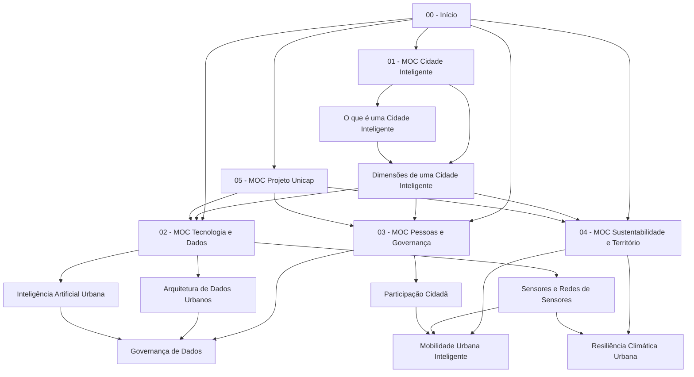

# 🕸️ 06 — Grafo do Conhecimento

Esta nota é o **mapa do mapa**: explica a topologia do cofre e como ler o grafo do Obsidian.

## Topologia

Uma estrela com cinco braços. [[00 - Início]] aponta para os MOCs; os MOCs apontam para as notas atômicas; as notas atômicas se cruzam entre si (é aí que nasce o conhecimento novo).

## Como ler o grafo no Obsidian

- **Abra o Graph View** (`Ctrl/Cmd + G`). As notas desta pasta são os nós; as setas são wikilinks.
- Ative **Groups** com filtros por pasta para colorir os cinco braços:
  - `path:tecnologia` · `path:pessoas` · `path:sustentabilidade` · `path:projeto` · `path:fundamentos`
- Nós com muitas conexões = conceitos de maior alavancagem. Hoje os hubs são [[Dimensões de uma Cidade Inteligente]], [[Arquitetura de Dados Urbanos]] e [[Governança de Dados]].
- Nós isolados = sinal de nota morta. Use a busca `-path:"00 - Início"` e confira se sobrou algo sem link de entrada.

## Regras de conexão

1. **Um link precisa de motivo.** Ao linkar, escreva meia frase dizendo *por que* aquelas notas se tocam ("porque sem X não há Y").
2. **Prefira link a repetição.** Não copie a definição de [[Dados Abertos]]; linke.
3. **Link bidirecional é dívida.** Se A linka B, volte a B e crie a conexão de retorno dentro de uma seção `## Conexões`.
4. **Nota grande demais é sintoma.** Acima de ~60 linhas, quebre em notas atômicas.

## Ferramentas que leem este grafo

- Obsidian Graph View / Local Graph.
- `grep -o '\[\[[^]]*\]\]'` para auditoria rápida de links quebrados.

## Conexões

- [[00 - Início]] — o índice que gera o grafo.
- [[Modelo de Nota]] — o formato que mantém o grafo consistente.
