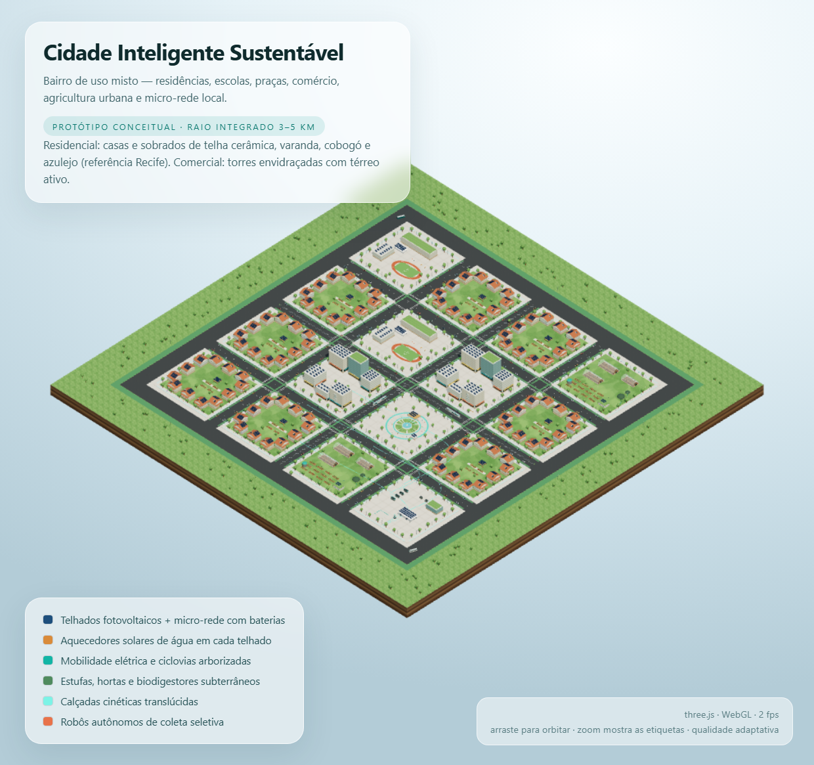
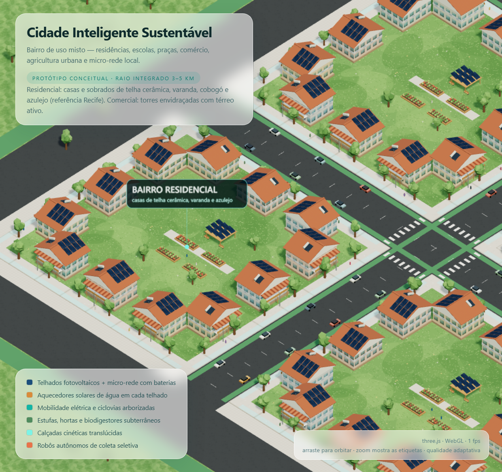

# Protótipo 3D da Cidade Inteligente

> Maquete isométrica navegável de um bairro de uso misto — residências, escolas, comércio, agricultura urbana e micro-rede local — empacotada como aplicação web executável, versionada junto do cofre.

## Definição

Uma cena `three.js` (WebGL) em câmera ortográfica isométrica que representa 16 quadras sobre uma plataforma de terreno. Cada quadra é um programa urbano: bairro residencial de telha cerâmica (referência Recife, com cobogó, varanda e azulejo), escola com pista, torres comerciais com térreo ativo, praça com fonte, agricultura urbana com estufas e biodigestores, e a micro-rede local com baterias. O HUD de vidro explica as camadas e a legenda mapeia cada cor a uma infraestrutura.

O objetivo não é simulação: é **comunicação visual** do conceito, para apresentar o projeto em reunião, banca ou feira sem depender de render estático.

## Como executar

**Link público (sem clonar, sem Node):** <https://cidade-inteligente-3d-prototipo-g48dfr.freebuff.site> — abre direto no navegador. É o mesmo build de `app/dist/`, publicado em produção no Freebuff Sites pelo manifesto `deploy/cidade-inteligente-3d/manifest.json`. O ambiente de `preview` do mesmo site serve o build idêntico em <https://cidade-inteligente-3d-prototipo-g48dfr-preview.freebuff.site> e existe para conferir antes de publicar.

Para rodar o executável na própria máquina, o build já vem compilado em `app/dist/`:

| Caminho | Como | Precisa de quê |
| --- | --- | --- |
| Servir o build (sem Node) | `python3 -m http.server 8080` dentro de `app/dist/` e abrir `http://localhost:8080` | Python 3 |
| Servir o build (com Node) | `npx vite preview` dentro de `app/` | Node |
| Rodar a fonte | `npm install` e depois `npm run dev` em `app/` | Node 20+ (abre em `http://localhost:3000`) |

Duplo clique em `app/dist/index.html` **não** funciona: o navegador bloqueia módulos ES carregados por `file://`. É preciso servir por HTTP — qualquer um dos três caminhos acima serve.

Controles: arraste para orbitar, roda do mouse ou pinça para o zoom — de 0,7× (visão geral) até **6×** (detalhe de telhado, varanda e canteiro). As etiquetas em 3D aparecem acima de 1,55× de zoom; o nível de detalhe da geometria acompanha o zoom.

## O que olhar em cada zoom

- **1× (visão geral):** a malha de 16 quadras, o anel verde de amortecimento e o eixo comercial cruzando o centro.
- **2–4×:** telhados fotovoltaicos, aquecedores solares, ônibus e carros circulando, robôs de coleta, calçada cinética, pedestres circulando e o reator da micro-rede (torre de anéis de plasma, ampliada para 2,4× o tamanho original).
- **6×:** telha cerâmica, cobogó, varanda, azulejo, canteiros, o pátio da escola e os pedestres andando pelas calçadas.

## Pedestres

96 NPCs articulados (tronco, cabeça, braços e pernas em `InstancedMesh` — 7 draw calls para a cidade inteira) percorrem as calçadas dos 16 quarteirões em `app/src/npcs.js`. Cada um sorteia sua própria rotina: andar (com ciclo de passo e balanço de braços), parar e olhar em volta, conversar de frente para o pedestre mais próximo, ou acenar. Durações de 1 a 10 s por estado, escolhidas por peso, de modo que a multidão nunca fica sincronizada.

O pack de personagens do CGTrader (Casual Character Pack Lite) ainda **não** está no repositório: o download exige conta logada no site e o servidor bloqueou o acesso anônimo (HTTP 202 sem conteúdo). Para trocar os bonecos procedurais pelos personagens do pack, basta baixar o ZIP com a conta de vocês, colocar o `.glb` em `app/public/` e avisar — a animação (Mixamo) e a malha de percursos já estão prontas, só muda a fonte visual.

## Capturas

## Limitações conhecidas

- A cena renderiza em ~1,4 ms por frame em GPU dedicada; o contador de FPS do HUD mede a taxa de apresentação do navegador. Em navegador remoto/streaming esse número cai para 1–4 fps mesmo com a cena barata — é ambiente, não o protótipo.
- Qualidade adaptativa: só degrada (0,85× de resolução, sem sombras) se o FPS cair **e** o custo de render passar de 18 ms. `?quality=full` na URL desliga a degradação.
- Não há dados em tempo real nem integração com sensores: os elementos (carros, ônibus, robôs) são animações de composição.

## Conexões

- [[05 - MOC Projeto Unicap]] — o protótipo é entregável de comunicação do projeto; entra no cronograma.
- [[02 - MOC Tecnologia e Dados]] — a stack é `three.js` + WebGL, o mesmo vocabulário do [[Gêmeo Digital Urbano]] em escala de maquete.
- [[Recife e a Agenda Urbana]] — a tipologia residencial (telha cerâmica, cobogó, varanda) é a referência local que dá credibilidade à cena.
- [[Indicadores de Sustentabilidade e ODS]] — cada camada visual (solar, micro-rede, agricultura, mobilidade ativa) existe para ancorar um indicador futuro.

## Perguntas abertas

- [ ] O protótipo deve virar base de um painel de indicadores (ver [[Dashboard de Indicadores]]) ou ficar como peça de comunicação?
- [ ] Vale adicionar camadas alternáveis (energia, água, resíduos) em vez de tudo visível ao mesmo tempo?
- [ ] Qual versão vai para a banca: o build aberto no navegador ou um vídeo de navegação gravado?
