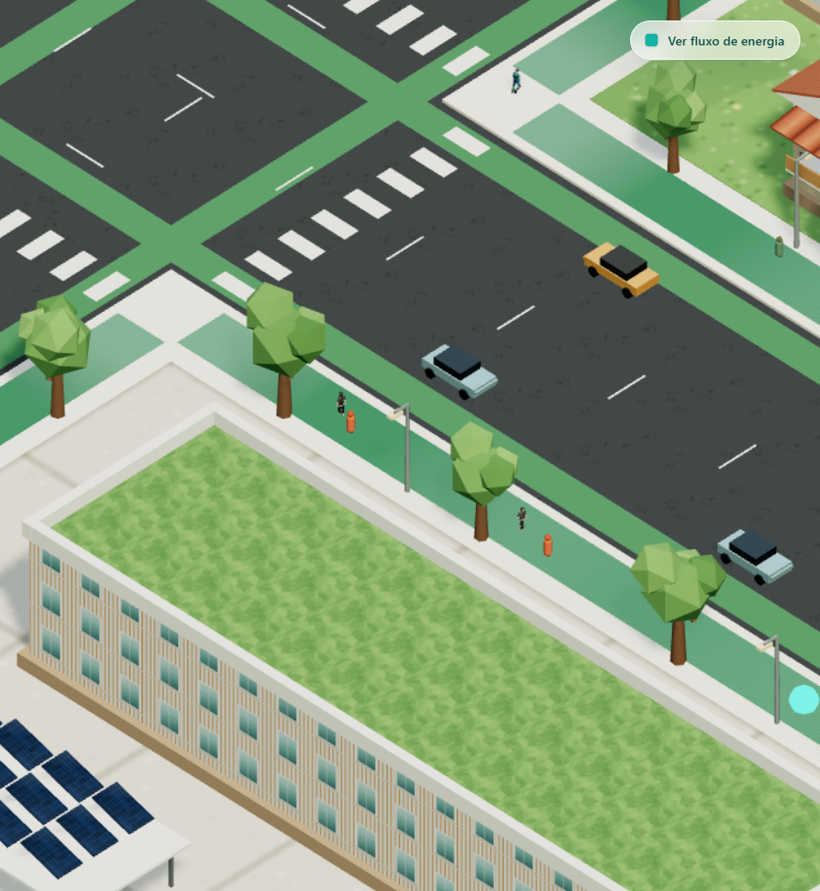
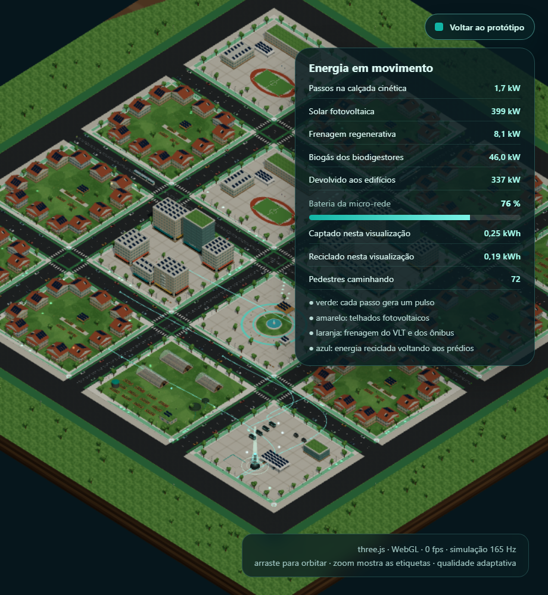

# Protótipo 3D da Cidade Inteligente

> Maquete isométrica navegável de um bairro de uso misto — residências, escolas, comércio, agricultura urbana e micro-rede local — empacotada como aplicação web executável, versionada junto do cofre.

## Definição

Uma cena `three.js` (WebGL) em câmera ortográfica isométrica que representa 16 quadras sobre uma plataforma de terreno. Cada quadra é um programa urbano: bairro residencial de telha cerâmica (referência Recife, com cobogó, varanda e azulejo), escola com pista, torres comerciais com térreo ativo, praça com fonte, agricultura urbana com estufas e biodigestores, e a micro-rede local com baterias. O HUD de vidro explica as camadas e a legenda mapeia cada cor a uma infraestrutura.

O objetivo não é simulação: é **comunicação visual** do conceito, para apresentar o projeto em reunião, banca ou feira sem depender de render estático.

## Como executar

**Link público (sem clonar, sem Node):** <https://cidade-inteligente-3d-prototipo-g48dfr.freebuff.site> — abre direto no navegador. É o mesmo build de `app/dist/`, publicado em produção no Freebuff Sites pelo manifesto `deploy/cidade-inteligente-3d/manifest.json`. O ambiente de `preview` do mesmo site serve o build idêntico em <https://cidade-inteligente-3d-prototipo-g48dfr-preview.freebuff.site> e existe para conferir antes de publicar.

Para rodar o executável na própria máquina, o build já vem compilado em `app/dist/`:

| Caminho | Como | Precisa de quê |
| --- | --- | --- |
| Servir o build (sem Node) | `python3 -m http.server 8080` dentro de `app/dist/` e abrir `http://localhost:8080` | Python 3 |
| Servir o build (com Node) | `npx vite preview` dentro de `app/` | Node |
| Rodar a fonte | `npm install` e depois `npm run dev` em `app/` | Node 20+ (abre em `http://localhost:3000`) |

Duplo clique em `app/dist/index.html` **não** funciona: o navegador bloqueia módulos ES carregados por `file://`. É preciso servir por HTTP — qualquer um dos três caminhos acima serve.

Controles: arraste para orbitar, roda do mouse ou pinça para o zoom — de 0,7× (visão geral) até **6×** (detalhe de telhado, varanda e canteiro). As etiquetas em 3D aparecem acima de 1,55× de zoom; o nível de detalhe da geometria acompanha o zoom. O botão **Ver fluxo de energia** no canto superior direito (ou a tecla **E**) alterna para a camada de energia descrita abaixo; o mesmo botão volta ao protótipo.

## O que olhar em cada zoom

- **1× (visão geral):** a malha de 16 quadras, o anel verde de amortecimento e o eixo comercial cruzando o centro.
- **2–4×:** telhados fotovoltaicos, aquecedores solares, ônibus e carros circulando, robôs de coleta, as calçadas cinéticas verdes, pedestres circulando e o reator da micro-rede (torre de anéis de plasma, ampliada para 2,4× o tamanho original).
- **6×:** telha cerâmica, cobogó, varanda, azulejo, canteiros, o pátio da escola, as faixas verdes embutidas na calçada branca e os pedestres andando sobre elas.

## Pedestres

96 NPCs percorrem as calçadas dos 16 quarteirões em `app/src/npcs.js`. Cada um sorteia sua própria rotina: andar (clipe `Walk.001`/`Walk.002`), parar e olhar em volta (`Idle`), conversar de frente para o pedestre mais próximo (`Idle`, com deslocamento de tempo sorteado) ou dançar (`Dance`). Durações de 1 a 10 s por estado, escolhidas por peso, de modo que a multidão nunca fica sincronizada.

Os personagens são o pack **Low Poly Characters Set Free** do CGTrader, riggado e já animado — o `.blend` original está em `3d-source/` e os glTF em `app/public/npcs/` (ver o README de lá). Foram unidos em uma malha por personagem (1 draw call por NPC) e a textura foi reduzida para 512 px em WebP; os 5 personagens compartilham os mesmos clipes porque o rig de 70 bones é idêntico. A velocidade de cada pedestre é derivada da passada medida no próprio clipe, então o pé acompanha o corpo (ver abaixo).

Custo: 96 malhas animadas somam ~96 draw calls e ~0,55 M triângulos (o dobro com sombras ligadas, acima de 1,55× de zoom). Em 6× a cena fica em ~2,2 M triângulos e 441 chamadas; por isso a qualidade adaptativa esconde metade dos pedestres no nível 2.

### Onde eles andam

Os 96 percursos ficam a **51,4 unidades** do centro de cada quarteirão — exatamente sobre a faixa cinética, que é embutida na calçada branca de 6 unidades e pintada de verde. Antes os percursos ficavam a 55,4–57,4, no leito da rua, e a faixa parecia um elemento separado da calçada. As árvores e luminárias do quarteirão continuam a 49,2, no lado interno da calçada.

### Escala, passo e taxa de quadros

A escala subiu para 0,80–0,90 (≈1,55–1,75 unidades de altura, ~20% maior que antes). A velocidade de cada pedestre não é sorteada: na carga, `npcs.js` amostra 48 quadros de `Walk.001`/`Walk.002`, soma o deslocamento horizontal de `footL`/`footR`/`toeL`/`toeR` por ciclo e usa a mediana como velocidade de solo (≈2,2 unidades/s no modelo, ~1,8 no mundo depois da escala). O `timeScale` da caminhada é `velocidade / (passada × escala)`, então o avanço do corpo casa com o pé. A fórmula anterior ignorava a escala do modelo e deixava ~30% de deslize; o resíduo que resta é do próprio clipe, cuja fase de apoio varia entre 1,65 e 3,02 unidades/s.

O laço de desenho roda em **165 Hz fixos**, num agendador próprio: a cada quadro ele soma 1/165 s ao prazo e usa `MessageChannel` quando o quadro já venceu ou `setTimeout` quando ainda falta tempo, sem depender do `requestAnimationFrame` (que fica preso ao refresh do monitor). A lógica dos pedestres usa o mesmo passo fixo de 1/165 s, e os mixers são atualizados uma vez por quadro, só para quem está dentro da vista. Medido com o render desligado, o laço crava **165 fps**; com o render ligado, o teto passa a ser a apresentação do canvas.

**Aproximação até 16×.** O `maxZoom` subiu de 6× para 16× e o botão direito (ou dois dedos) desloca a vista, com o alvo preso a ±240 do centro. Para o close não quebrar o enquadramento: a sombra acompanha o alvo e o frustum de sombra fecha de 430 para 70 de raio (o mapa de 2048 sai de 0,42 para 0,068 unidade por texel); as etiquetas encolhem para ~26% da largura da tela e somem acima de 9×; o cartão de introdução some acima de 4,5×. Em 16× a vista fica em 47 chamadas e 172 mil triângulos — mais barata que a visão geral. Um botão **Vista geral** ao lado do botão de energia faz esse retorno com um toque, e o mesmo acontece com **duplo clique** no canvas, **Home** no teclado ou **duplo toque** no celular: alvo (0, 4, 0) e zoom 1×, sem perder a orientação da órbita. A volta é uma transição de 0,55 s com easing (alvo e zoom deslizam juntos), e qualquer toque, arrasto ou giro da roda no canvas cancela a animação. O duplo toque exige os dois toques em até 350 ms e a menos de 26 px um do outro, e só dispara quando o último dedo sai da tela — fim de pinça ou de arrasto com dois dedos não volta a vista.

## Energia em movimento

O botão **Ver fluxo de energia** (ou a tecla **E**) troca a cena clara pelo modo noturno de energia, sem sair do protótipo: o fundo escurece, as luzes caem e entra uma camada de leitura com painel, arcos e pulsos.

- **Captação cinética:** cada passo de um pedestre na faixa verde emite um pulso que corre até o nó de energia do quarteirão e sobe em arco até o hub da micro-rede. O painel mostra a soma em kW, proporcional ao número de pedestres andando.
- **Solar fotovoltaica:** arcos amarelos saem dos 113 telhados com painel e convergem para o hub.
- **Frenagem regenerativa:** pulsos laranja saem do VLT e dos ônibus, com intensidade maior perto dos cruzamentos (onde a frenagem acontece).
- **Biogás:** pulsos dos robôs de coleta e dos biodigestores da agricultura urbana.
- **Armazenamento e reciclagem:** anéis pulsando no hub, bateria com carga em %, e pulsos azuis do hub de volta aos prédios — a energia reciclada.

Todos os números do painel são de simulação (não há sensores): o rodapé diz isso e os acumulados de kWh contam desde que o modo foi aberto. A camada é só visual — não altera percursos, veículos nem o custo da cena fora do modo.

## Capturas

## Limitações conhecidas

- O HUD mostra `fps` (quadros por segundo do laço, teto 165), `render X ms` (custo do quadro) e a marca `laço 165 Hz`. Na visão geral o render custa ~4 ms (299 chamadas, ~1 M triângulos); em 3× com LOD alto, ~8 ms. Em navegador remoto/streaming o `fps` cai para 1–2 **com o render ligado** e volta a 165 com `renderer.render` desligado — medido: o bloqueio está no swap do canvas desse ambiente, não na cena. Numa tela de 60 Hz o monitor continua mostrando 60 mesmo com o laço a 165; os quadros extras são descartados e custam GPU.
- Qualidade adaptativa: só degrada (0,85× de resolução, sem sombras) se o FPS cair **e** o custo de render passar de 18 ms. `?quality=full` na URL desliga a degradação.
- Não há dados em tempo real nem integração com sensores: os elementos (carros, ônibus, robôs) são animações de composição.

## Conexões

- [[05 - MOC Projeto Unicap]] — o protótipo é entregável de comunicação do projeto; entra no cronograma.
- [[02 - MOC Tecnologia e Dados]] — a stack é `three.js` + WebGL, o mesmo vocabulário do [[Gêmeo Digital Urbano]] em escala de maquete.
- [[Recife e a Agenda Urbana]] — a tipologia residencial (telha cerâmica, cobogó, varanda) é a referência local que dá credibilidade à cena.
- [[Indicadores de Sustentabilidade e ODS]] — cada camada visual (solar, micro-rede, agricultura, mobilidade ativa) existe para ancorar um indicador futuro.

## Perguntas abertas

- [ ] O protótipo deve virar base de um painel de indicadores (ver [[Dashboard de Indicadores]]) ou ficar como peça de comunicação?
- [x] Vale adicionar camadas alternáveis (energia, água, resíduos) em vez de tudo visível ao mesmo tempo? — a camada de energia existe (botão **Ver fluxo de energia** / tecla **E**); água e resíduos seguem em aberto.
- [ ] Qual versão vai para a banca: o build aberto no navegador ou um vídeo de navegação gravado?
